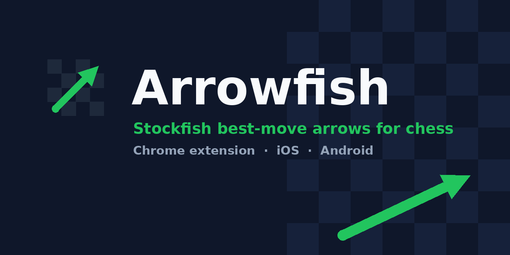

<p align="center"></p>

# Arrowfish for phone (iOS and Android)

A chess app with **Stockfish** built in. Play the computer, or analyse both sides, with a **best-move arrow** drawn on the board. Runs fully offline once installed.

- Tap-to-move board with legal-move dots, check/mate/draw detection, undo, flip
- Computer levels: Easy / Medium / Hard; play White or Black
- Best-move arrow toggle
- Installable as a PWA on iPhone and Android, or built as a native app with Capacitor


## Quick start (GitHub Pages - no computer tools needed on the phone)

1. Push this folder to a GitHub repo named `Arrowfish-phone`.
2. Settings -> Pages -> Source: **GitHub Actions**. The included workflow downloads the engine and publishes `www/`.
3. Open the Pages URL on your phone: **iPhone** Safari -> Share -> Add to Home Screen; **Android** Chrome -> menu -> Install app.

## Local run

```bash
node scripts/setup.mjs   # downloads Stockfish + chess.js into www/lib
npx serve www            # open the printed URL
```

## Native apps

See [MANUAL.md](MANUAL.md): `npm install`, then `npm run android` (Android Studio) or `npm run ios` (Mac + Xcode).

Desktop version: [Arrowfish-desktop](../Arrowfish-desktop).

## License

MIT for Arrowfish code. Stockfish (GPLv3) and chess.js (BSD-2) are downloaded separately.
